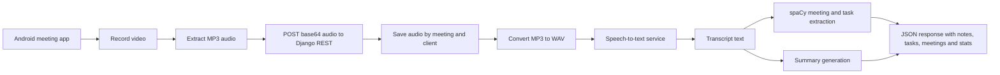

# SmartMeetings

Android and Django prototype that turns recorded meeting audio into transcript summaries, tasks, meeting items and engagement stats.


## Overview

SmartMeetings is a 2019 to 2022 team project. The repository contains:

- `CodieconMeeting`, an Android client that records video, extracts audio and sends base64 audio to the backend.
- `Backend`, a Django REST API that accepts audio, converts MP3 to WAV, calls a speech-to-text service, summarises the transcript and extracts action items.
- `NLP`, an extra Python entry point for text processing experiments.

GitHub contributors: `rishabhjain9196`, `abhirup-mondal`, `sanket10`.

## Architecture



## Features

| Area | What the code does |
| --- | --- |
| Mobile capture | `MeetingFragment` launches camera capture, stores a video file and uses `AudioExtractor` to write an MP3 audio track. |
| Backend upload | `POST /AudioProcessor/send_audio` accepts JSON containing base64 audio under `key`. |
| Audio processing | The backend saves client audio, converts MP3 to WAV with `ffmpeg`, processes each WAV file and builds engagement percentages from transcript length. |
| Transcript analysis | `nlp.py` uses spaCy sentence parsing to identify meeting items and tasks from transcript sentences. |
| Response format | The API returns summary text, extracted meetings, extracted tasks and engagement stats. |

## API overview

| Method | Path | Purpose |
| --- | --- | --- |
| `GET` | `/AudioProcessor/` | Health check text response. |
| `POST` | `/AudioProcessor/send_audio` | Process uploaded meeting audio and return extracted meeting data. |

## Tech stack

| Layer | Technologies |
| --- | --- |
| Android app | Java, Android Support libraries, Gradle, `MediaExtractor`, `MediaMuxer` |
| API | Django 2.2, Django REST framework, SQLite |
| Audio and NLP | `ffmpeg`, pydub, speech-to-text SDK, gensim summarisation, spaCy |

## Project structure

```text
SmartMeetings/
  Backend/
    AudioProcessor/        Django REST app for upload, audio conversion and NLP
    smartMeetings/         Django project settings and URL routing
    requirements.txt       Python dependencies
  CodieconMeeting/         Android client project
  NLP/                     Standalone NLP experiment
  README.md
```

## Getting started

### Backend

```bash
cd Backend
python -m venv .venv
source .venv/bin/activate        # Windows: .venv\Scripts\activate
pip install -r requirements.txt
python manage.py migrate
python manage.py runserver 0.0.0.0:8000
```

Notes:

- Install `ffmpeg` before testing audio conversion.
- Install the spaCy English model expected by the code.
- The code contains local service settings in Python modules. Move service credentials, service region and backend host settings to environment variables before using the project outside a local experiment.
- The Android client posts to a local network address in `HandlingData.java`; update that host to match the running backend.

### Android client

```bash
cd CodieconMeeting
./gradlew assembleDebug          # Windows: gradlew.bat assembleDebug
```

Use Android Studio or the Gradle wrapper with an Android SDK installed.
